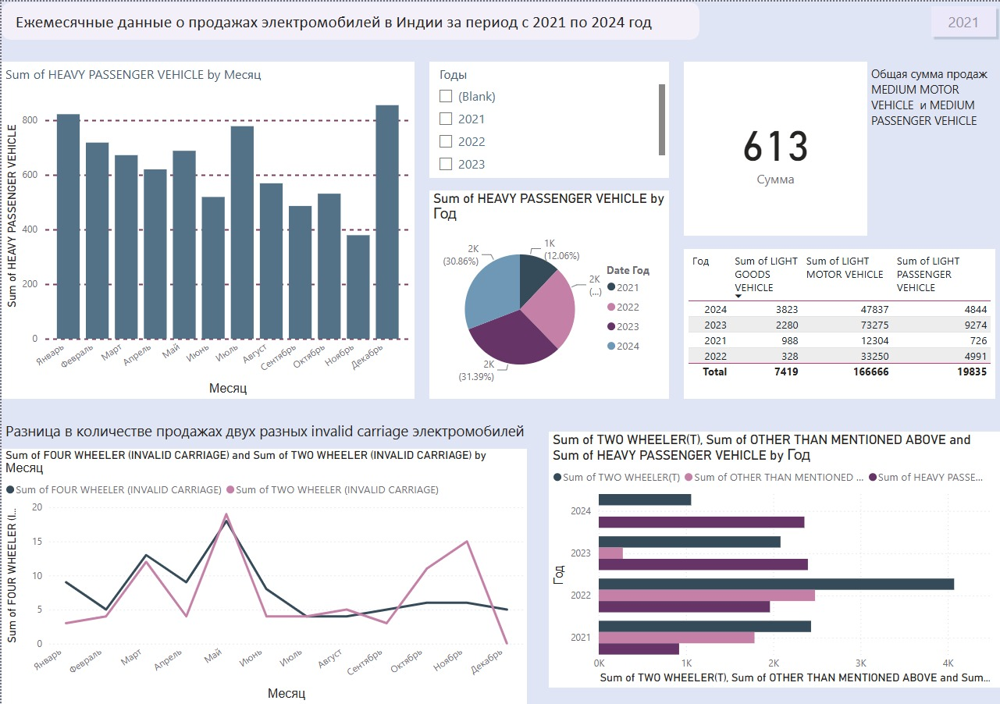
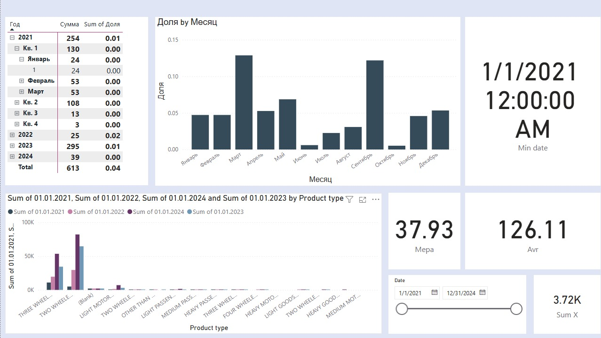

# india-ev-sales-powerbi
# Анализ продаж электромобилей в Индии, 2021–2024 (Power BI)

Интерактивный дашборд по месячным продажам электромобилей в Индии
по категориям транспорта: динамика, доли категорий, сравнение с прошлым годом.

## Скриншоты

## Данные
- Месячные продажи электромобилей в Индии по категориям транспорта,
  январь 2021 — декабрь 2024

## Что я сделала
**Power Query**
- Загрузила листы за 2021, 2022, 2023 и 2024 годы и объединила их в одну таблицу (Append).
- Привела типы данных, добавила столбец «Год».
- Транспонировала таблицу, чтобы получить срез «категория × месяц».

**Модель данных**
- Таблица фактов продаж, календарь (Date table), справочник типов транспорта `Vehicles`.

**Отчёт**
- 3 страницы: обзор по месяцам и годам, доли и суммы, сравнение периодов.
- Интерактивные срезы по году, дате и типу транспорта, drill-down по иерархии дат.

## Инструменты
Power BI Desktop, Power Query, DAX.

## Как открыть
Скачайте файл `Dashboard_YerkezhanK.pbix` и откройте в Power BI Desktop (Windows).
